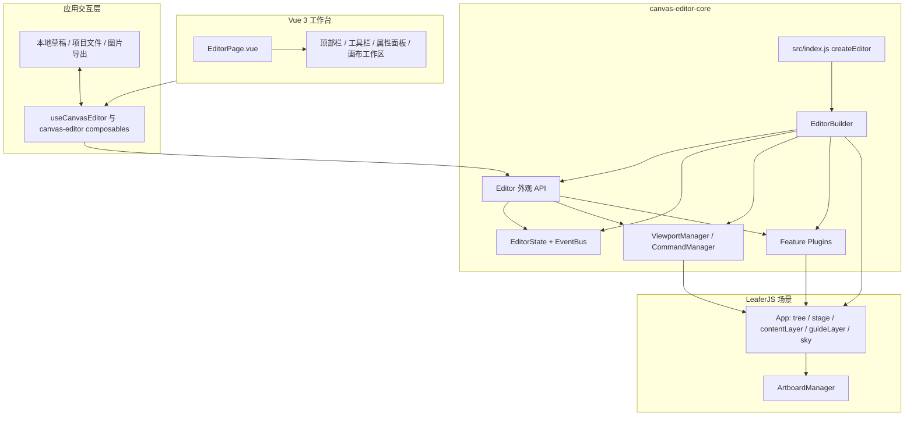

# Canvas Editor

一个受 iOS 设计语言启发的浏览器画板，提供明亮的玻璃质感工作台、可编辑图层和本地文件工作流。项目使用 Vue 3、Vuetify 与 LeaferJS 构建，不依赖业务后端，也不要求账号或云端服务。

> 这是一个独立的开源编辑器项目，不是 Apple 产品，也不隶属于 Apple。

## 功能

- 在画布中添加和编辑文字、导入图片并替换图片。
- 管理图层顺序、可见性、锁定状态和组合关系。
- 调整画板尺寸、背景和水印；通过滚动、拖动画布、缩放和适配视图浏览工作区。
- 撤销和重做编辑操作。
- 自动在浏览器 IndexedDB 中保存本地恢复草稿。
- 导入和导出可继续编辑的 JSON 项目，导出 PNG 或 JPG 图片。
- 使用系统字体和本机选择的图片；编辑数据默认保留在本机。

## 快速开始

需要 Node.js `22.12` 或更高版本。

```sh
git clone <repository-url>
cd <repository-directory>
npm ci
npm run dev
```

打开 Vite 显示的本地地址即可使用。首次打开会显示空白工作区，可添加文字、导入图片或载入示例。

```sh
npm run check       # ESLint、测试、生产构建和公开文件检查
npm run build       # 生成 dist/ 静态站点
npm run preview     # 本地预览生产构建
```

## 项目架构



### 模块职责

| 模块 | 位置 | 职责 |
| --- | --- | --- |
| 工作台界面 | `src/views/`、`src/components/editor-shell/` | Vue 页面、导航、属性面板、工具栏和画布交互界面 |
| 应用状态与本地工作流 | `src/composables/` | UI 状态编排、文件选择、本地草稿恢复和图片导出 |
| 编辑器入口 | `src/index.js` | 导出 `createEditor()` 和可复用的内核 API |
| 编辑器组装 | `src/core/EditorBuilder.js` | 创建 Leafer 场景、状态、视口、命令和默认插件 |
| 编辑器门面 | `src/core/Editor.js` | 提供一致的高层 API，将操作委托给各子系统 |
| 画布服务 | `src/viewport/`、`src/commands/`、`src/logic/` | 视口平移缩放、撤销重做和事件通信 |
| 功能插件 | `src/plugins/feature-plugins/` | 文本、图片、图层、文档、历史、自定义元素属性及 SVG 栅格缓存 |
| 渲染场景 | LeaferJS `tree` / `sky` | 分离内容渲染与编辑器控件层，支持缩放、选择和画布编辑 |

编辑器内核使用建造者模式组装、外观模式统一 API、Proxy 管理状态、策略模式切换视口缩放、命令模式记录历史，并通过事件总线和插件生命周期保持模块解耦。

### 文档与数据流

项目文件采用带版本号的 JSON 文档格式。导入时先校验文档并准备图片、字体资源，再替换当前场景；导出时序列化画板尺寸、元素和可恢复的编辑属性。自动恢复草稿使用浏览器 IndexedDB，导出的 JSON 与图片由浏览器下载，不会上传到本项目的服务端。

手动导入的项目可能包含外部图片或字体地址；浏览器会按文档内容尝试加载这些地址。不要导入来源不明的项目文件。

## 独立使用编辑器内核

仓库包含一个不依赖完整 Vue 工作台的原生示例：运行开发服务器后访问 `/examples/index.html`。也可在自己的界面中创建编辑器：

```js
import { createEditor } from './src/index.js';

const editor = createEditor({
  view: document.querySelector('#canvas'),
  autoResize: true,
  artboard: { width: 600, height: 400 }
});

editor.text.add({ text: 'Hello, canvas!' });
editor.fitArtboardToView();
```

使用 LeaferJS 内核的独立集成还需要安装 `package.json` 中列出的 Leafer peer dependencies。应用开发依赖可通过 `npm ci` 一次安装。

## 开发 SKILL

项目提供一个面向 AI 编码助手的可选架构指南：[`canvas-editor-core` SKILL](.agents/skills/canvas-editor-frontend/SKILL.md)。它记录 LeaferJS 场景结构、模块边界、核心设计模式、命名规范和测试约定。该 SKILL 仅用于辅助开发，不是运行时依赖。

## 目录结构

```text
src/
  components/editor-shell/   Vue 编辑器工作台与面板
  composables/               应用状态、本地工作流和交互逻辑
  core/                      Editor、EditorBuilder、EditorState
  plugins/feature-plugins/   文本、图片、文档、历史、图层等插件
  viewport/                  视口管理与缩放策略
  commands/                  可撤销命令
  logic/                     事件总线
  utils/                     文档、图片、文本和画布工具
examples/                    内核独立使用示例
tests/                       内核和应用交互测试
scripts/                     检查与安全公开导出脚本
```

## 开源导出

主工作区可能包含未公开文件或尚未整理的 Git 历史。公开时使用仓库提供的白名单导出器，它只复制允许公开的应用源代码、测试、示例、文档和配置，并创建一个没有提交记录和远程地址的新 Git 仓库。

```sh
npm run export:public
cd .public-export/canvas-editor
npm ci
npm run check
```

导出器会拒绝覆盖已存在的目标目录，并运行 URL 与凭证扫描。公开之前仍需由维护者审查代码权属、依赖许可和最终导出内容。

## 许可证

本项目采用 MIT License，详见 [LICENSE](LICENSE)。第三方依赖及其许可见 [THIRD_PARTY_NOTICES.md](THIRD_PARTY_NOTICES.md)。
